# 云深处 M20 Pro 轮足机器人山野巡检自主建图与导航方案

## 方案目标 (Goal Description)
本项目旨在基于**云深处（DEEP Robotics）山猫 M20 Pro 轮足式机器人**，搭载 **NVIDIA Jetson Orin NX 16GB** 边缘计算单元，构建面向小山/山野复杂地形的“巡山机器人”软硬件感知、建图与导航系统。
参考朗毅机器人山野地形实测成果，攻克非结构化山地中大高差连续起伏、树荫特征退化、非平坦路面台阶跨越等难点。
研发路线坚持“**本地 Gazebo 仿真优先收敛，再向实机无缝迁移**”策略，实现：
1. 首次遥控建图：高精度 3D 激光惯导里程计 + 局部/全局回环检测约束 + RTK 因子图优化；
2. 地形空间表达：基于 GPU 加速的 2.5D 高程图（Elevation Map）与通行度评估（Traversability Analysis）；
3. 轮足自适应导航：平坦地形轮式高效行进，阶梯/障碍地形动态触发抬脚踏步（Gait Switching）越障巡山。

> [!IMPORTANT]
> **合规基准声明**：依据用户明确要求，本方案**严禁自行编造任何量化数值**（如未实测的坡度度数、台阶高度上限、续航时间、定位绝对误差范围等）。凡涉及具体物理规格、性能指标与阈值，均以官方发布的白皮书参数为基准；未指定或需实地调优的参数统一标注为 `[待确认/待实测标定]`，并纳入《模糊需求澄清清单》。

---

## 视频参考内容深度总结与关键技术映射
**参考视频**：哔哩哔哩 `BV13xhW6aEMX`《国内首发！四足机器人山野地形导航实测》（UP主：朗毅机器人）

### 1. 视频核心场景与痛点分析
* **地形环境**：未经人工硬化的山野林区，伴随泥泞土路、碎石斜坡、枯枝杂草、不规则天然石阶与排水沟壑。
* **主要难点**：
  * **2D 导航失效**：传统 2D 占据栅格地图（Occupancy Grid）会将所有坡道与台阶判定为不可通行的障碍物壁障，导致全局与局部规划器锁死或剧烈摆动。
  * **几何与光照剧烈变化**：树荫光斑导致纯视觉深度相机（RGB-D）点云空洞/噪点严重；林木落叶导致轮式打滑，纯轮速计里程计累计发散极快。
  * **高程连续性**：需要实时感知前向地面几何形态的高低差（Elevation Profile），判定是可通过的斜坡、需抬脚踏步跨越的台阶，还是不可跨越的断崖。
* **视频实现的工程表现**：机器人全程自主巡航，无人工遥控干预；在上坡、下坡和石阶处姿态平稳，步态自适应微调，未发生打滑侧翻或轨迹丢失。

### 2. 映射到本项目技术栈的选型结论
| 视频展现能力 | 映射技术模块 | 本项目拟采用方案 |
| :--- | :--- | :--- |
| 剧烈颠簸下稳定高频定位 | 3D LiDAR-Inertial Odometry | 紧耦合 LIO（AA-FasterLIO / Point-LIO 前端），融合高频内置 IMU |
| 大范围山林闭环一致性 | 全局位姿图优化 (PGO) | 3D 局部子图一致性匹配 + 回环位姿图优化（GTSAM / PGO） |
| 坡道与落差精细几何建模 | 2.5D / 3D 地形拓扑表达 | GPU 加速 2.5D 高程图 (`elevation_mapping_cupy`) |
| 台阶/断崖可通行度辨识 | 地形多层代价计算 | 多图层可通行度滤波器（坡度、粗糙度、台阶阶差分析） |
| 轮-足形态协同过坎越障 | 运动模式自适应切换 | 状态机/行为树驱动的轮式滑行与抬脚踏步模式切换决策 |

---

## 核心架构决策与选型深度评估 (Architecture Decisions & Evaluation)

### 1. 主激光雷达方案：Livox Mid-360 深度集成架构

#### 1.1 传感器特性与优先选用裁决
经与 RoboSense Airy 及传统机械式激光雷达深入对比，本项目**确定优先采用 Livox Mid-360 作为主激光雷达**，核心裁决依据如下：
* **大范围立体视场覆盖（360° × 59°）**：Mid-360 具备水平 360°、垂直 -7° 至 52° 的大视场 `[官方标称]`。在山地巡检场景中，-7° 俯视向下覆盖机器狗前向近地盲区（台阶、沟壑、落水坑），52° 仰视向上覆盖前向陡峭山坡、树冠与岩石结构，彻底解决传统薄线束雷达在上坡仰头时“看天不看地”或俯冲下坡时“只看地不见前路”的几何视场断裂问题。
* **硬件级微秒级时间同步（根除外置 IMU 时钟抖动）**：Mid-360 内部集成了 6 轴高频 MEMS IMU（输出频率标称 200 Hz `[官方标称]`）。激光脉冲发射与 IMU 数据采集在雷达内部 FPGA 芯片硬件时钟下完成打标，彻底避免了外置 IMU 经由串口或以太网传输时的操作系统级时钟漂移、PTP/gPTP 协议配置复杂性及丢包抖动。在轮足踏步剧烈颠簸工况下，微秒级硬同步是保障 LIO 连续收敛的生命线。
* **紧凑尺寸与轻量化匹配**：机身尺寸仅 65 × 65 × 60 mm，重量约 265g `[官方标称]`，安装于 M20 Pro 躯干背部几何中心偏前位置，对机器狗整体质心（CoM）与转动惯量的扰动极小。
* **测距能力与点频特性**：测距范围 40m @ 10% 反射率 / 70m @ 80% 反射率 `[官方标称]`，激光点频标称 200,000 点/秒（单回波 100,000 点/秒，双回波 200,000 点/秒 `[官方标称]`），满足山野中远距离树林与岩石回环几何特征提取需求。
* **成熟完备的 ROS 2 与开源 SLAM 生态**：官方提供原生支持 ROS 2 Humble 的 `livox_ros_driver2`，FAST-LIO、Faster-LIO、Point-LIO、lightning-lm 等开源算法均原生适配其专属数据包格式，大幅压缩适配工程周期。

#### 1.2 驱动层拓扑与数据流设计
在 Jetson Orin NX (Ubuntu 22.04 LTS + ROS 2 Humble) 环境下部署 `livox_ros_driver2`：
* **物理通信接口**：百兆以太网 (100BASE-TX) UDP 协议连接，配置 Orin NX 与 Mid-360 处于同网段静态 IP（主机 IP: `[待实测配置]`, 雷达 IP: `[待实测配置]`）。
* **驱动输出模式选择**：
  * **模式 A（LIO 前端专用）**：发布原生自定义点云话题 `/livox/lidar`（消息类型：`livox_ros_driver2/msg/CustomMsg`），其中每个激光点均包含纳秒/微秒级相对时间戳 `offset_time`，专供 AA-FasterLIO 或 Point-LIO 前端进行连续时间轨迹内插运动去畸变。
  * **模式 B（高程建图与可视化）**：同步发布标准点云话题 `/livox/points`（消息类型：`sensor_msgs/msg/PointCloud2`），供 `elevation_mapping_cupy` GPU 高程图生成及 RViz2 监控渲染。
  * **IMU 话题**：发布 `/livox/imu`（消息类型：`sensor_msgs/msg/Imu`，频率标称 200 Hz `[官方标称]`），包含 3 轴角速度与 3 轴线加速度。

#### 1.3 外参标定全生命周期策略
外参精度直接决定多传感器融合与高程建图的建图精度，必须严格执行以下多阶段标定准则：
1. **LiDAR 到内置 IMU 外参（$T_{imu}^{lidar}$）**：
   * 该外参在出厂前由大疆览沃高精度标定台实测标定并固化在雷达固件中，驱动程序可自动读取或由官方参数表给定，初始化直接加载。
2. **LiDAR/IMU 到机器狗本体坐标系（$T_{base\_link}^{lidar}$）**：
   * **初始粗标定**：提取 M20 Pro 顶盖安装孔位及雷达结构件的 3D CAD 模型装配尺寸，获取理论标称平移量 $[x, y, z]$ 与理论对齐旋转角 $[roll, pitch, yaw]$。
   * **静态重力矢量对齐（Roll / Pitch 修正）**：机器狗静止站立于绝对水平校验地面上，通过内置 IMU 在静止状态下的重力加速度计矢量投影，高精度求解机体水平姿态与雷达横滚角、俯仰角安装残差。
   * **动态平动与旋转手眼标定（Yaw 及平移微调）**：在开阔平整场地遥控 M20 Pro 进行平面“8”字形巡航与定点自转运动，采用基于 B 样条轨迹连续时间对齐方法（或 LI-Init / 手眼标定工具）联合求解水平偏航角（Yaw）及平移外参。
   * **几何物理残差验证**：引导机器人贴近垂直平面墙面并在水平地面往复行进，核验投影至 `base_link` 坐标系下的地面点云法向量垂直度（误差需满足水平度要求 `[待实测标定]`）以及墙面点云厚度。
3. **LiDAR 到辅助传感器外参（$T_{camera}^{lidar}$, $T_{gnss}^{lidar}$）**：
   * **LiDAR 到 RealSense D435i**：采用基于标定板（棋盘格/圆形标定板）的激光-视觉联合标定工具，对齐点云与 RGB 像素，获取变换矩阵 `[待实测标定]`。
   * **LiDAR 到 RTK-GNSS 杆臂向量（Lever Arm）**：通过 CAD 装配基准结合室外 RTK 轨迹基线动态对齐，精确标定两者偏置 `[待实测标定]`。
   * *严格声明*：具体外参数值取决于机械结构件加工公差与实际安装孔位，工程代码中初始填入 CAD 理论值，实机联调时必须实测覆写，严禁凭空设定固定标定矩阵。

---

### 2. SLAM 算法深度评判：`lightning-lm-deep-robotics` vs `Point-LIO + Scan Context + GTSAM`

为从根本上锁定巡山机器人的建图与定位核心算法架构，针对云深处官方维护的 **`lightning-lm-deep-robotics`** 与开源社区经典的 **`Point-LIO + Scan Context + GTSAM`** 组合，展开 5 大维度的系统级深度评判：

```mermaid
graph LR
    subgraph 方案 A: lightning-lm-deep-robotics (云深处官方闭环)
        A1[Mid-360 CustomMsg + IMU] --> A2[AA-FasterLIO 前端]
        A2 -->|iVox 增量哈希| A3[局部子图 Submap 匹配]
        A3 -->|几何一致性检查| A4[内置全局位姿图 PGO]
        A4 --> A5[2D 占据栅格 / 3D PCD 动态切块保存]
    end

    subgraph 方案 B: Point-LIO + Scan Context + GTSAM (社区拼装方案)
        B1[Mid-360 CustomMsg + IMU] --> B2[Point-LIO 前端]
        B2 -->|流形 EKF 逐点更新| B3[纯里程计位姿]
        B3 & B1 --> B4[外部 Scan Context 极坐标描述子]
        B4 -->|环键检索 + 柱状对齐| B5[外部 GTSAM ISAM2 因子图优化]
        B5 --> B6[外置地图拼接工具]
    end
```

#### 2.1 算法底层架构与实现对比
* **`lightning-lm-deep-robotics`**：
  * 云深处机器人官方实验室维护的激光惯导多会话建图系统（基于高翔 `lightning-lm` 架构优化）。
  * **前端**：采用自适应加速版本 AA-FasterLIO，核心采用空间哈希增量体素网格（**iVox**）替代传统的 `ikd-tree`，彻底消除动态平衡树重构开销；配合迭代误差状态卡尔曼滤波（**IESKF**），在点云帧级进行高效状态更新。
  * **后端**：原生内置局部子图（Submap）空间距离触发机制，通过 3D 点云局部子图间的 ICP/NDT 配准与几何残差一致性校验进行回环约束检测，内置位姿图优化器（PGO）自动修正累积漂移，并原生集成 3D 点云切块加载与 2D 导航占据栅格地图导出。
* **`Point-LIO + Scan Context + GTSAM`**：
  * 香港大学 MaRS 实验室研发的高频里程计 + 外部回环/因子图组件。
  * **前端**：基于流形连续时间运动学方程（Manifold EKF），创新性采用**逐点（Point-by-point）或微批次（Micro-batch）状态更新**。每个激光点进入系统时，利用其自身纳秒级时间戳直接代入观测方程更新系统状态协方差，无需显式的帧级运动去畸变。
  * **后端（需拼装外部三方库）**：Point-LIO 仅输出里程计。回环需借助外部 Scan Context（将 3D 点云投影为方位角-径向环的 2D 极坐标最大高度矩阵，通过环键哈希检索候选帧），并由外部 GTSAM 框架构建 ISAM2 因子图优化器进行全局求解，地图保存需自研独立节点。

#### 2.2 五大维度深度对比矩阵
| 评估维度 | `lightning-lm-deep-robotics` | `Point-LIO + Scan Context + GTSAM` | 深度技术评析与优势对比结论 |
| :--- | :--- | :--- | :--- |
| **1. Jetson Orin NX 16GB 计算能效** | **极高（CPU 占用极低）**<br>iVox 基于空间哈希表，内存连续访问友好，$O(1)$ 查找插入，释放宝贵 CPU 算力给 Nav2 局部规划与底盘控制，保留 GPU 专用通道给 `elevation_mapping_cupy` | **中等偏低（CPU 压力较大）**<br>逐点/微批次矩阵求逆与更新开销大（Mid-360 达标称 20 万点/秒）；Scan Context 极坐标特征提取与 GTSAM ISAM2 多进程跨节点通信加剧 CPU 调度开销与发热降频风险 | **lightning-lm 胜出**：Orin NX 上 GPU 需全力支撑高程图与局部规划，CPU 必须保持轻量化以保障实时性与低发热。 |
| **2. Mid-360 支持与非重复扫描契合度** | **高度契合**<br>原生支持 Livox CustomMsg；iVox 空间体素网格具备历史点云时间累积特性，完美适配 Mid-360 静止/慢速行进时点云随时间逐渐增密的玫瑰线扫描特性 | **高度契合**<br>原生专为固态非重复扫描雷达设计，逐点时间更新机制完美贴合激光脉冲连续射击时序，无需依赖规则线束模式 | **平局（两者均原生深度支持 Mid-360）** |
| **3. IMU 动力学紧耦合与冲击抗扰性** | **良好**<br>基于 IESKF 离散时间惯导积分；在平坦路面轮式行驶表现优异；但在连续台阶踏步剧烈撞击工况下，需精细调优加速度过程噪声协方差 $Q_a$ `[待实测标定]` 以防冲击发散 | **极致卓越**<br>基于流形的高频 EKF 具备极强的极限动态适应性（耐受剧烈冲击与大幅角速度跳变），在四足踏步落脚触地冲击下姿态跟踪鲁棒性极高 | **Point-LIO 胜出**：Point-LIO 的逐点流形更新在剧烈颠簸撞击场景下的物理动力学鲁棒性经过极限机动验证。 |
| **4. 山野非结构化环境回环稳定性** | **极高（3D 局部子图一致性）**<br>采用 3D 局部子图配准与距离启发式空间几何校验，天然适应连绵起伏山体（10°~25° 坡度）与自然岩石形态，无投影维度损失，不易受季节落叶或树荫晃动干扰 | **中等（易受假阳性回环困扰）**<br>Scan Context 依靠 2D 极坐标最大高度投影。在自然山林中：1) 树冠晃动导致高度不连续；2) 均质起伏山丘缺乏垂直建筑立面，极坐标特征区分度差；3) 沿山道反向遍历或大俯仰变化时因坡度投影畸变极易产生误匹配 | **lightning-lm 胜出**：Scan Context 设计初衷为城市规整街道（垂直墙面建筑物），在山地非结构化环境下假阳性率高。 |
| **5. 云深处 M20 Pro 生态集成度** | **官方原生级契合**<br>云深处官方 GitHub 仓库维护，与 M20 Pro 底盘坐标系、驱动协议、ROS 2 话题体系开箱即用无缝打通；自带 2D/3D 切块地图保存管理 | **低（异构多仓库拼装维护成本高）**<br>Point-LIO + SC-A-LOAM + GTSAM 分属不同开源维护者，需自研胶水代码（Glue code）打通数据接口、坐标系转换与地图保存，维护与升级风险高 | **lightning-lm 胜出**：官方第一方支持大幅降低多智能体协作与实机部署迁移的工程集成风险。 |

> [!NOTE]
> **官方机器狗越障指标校核**：云深处官方白皮书显示，山猫 M20 系列具备 **台阶攀爬 20~25cm，最大爬坡 45°，单步越障 80cm** 的越障性能 `[官方标称]`。仿真世界中设计的 0.15m (15cm) 连续石阶与 16.7° 绕行坡道均在其物理越障能力安全包线以内，具备完全真实的仿真评测效度。

#### 2.3 选型结论与工程落地策略
* **首选与基线锁定：`lightning-lm-deep-robotics`**
  * **裁决理由**：在 Jetson Orin NX 16GB 资源受限平台上，其 CPU 能耗比显著优于 Point-LIO，能为 GPU 2.5D 高程图（`elevation_mapping_cupy`）预留充裕的硬件带宽；官方第一方生态支持使得坐标系与底盘通信契合度最高；3D 局部子图空间几何一致性校验能够有效杜绝山野环境下的回环误匹配。
* **工程容灾预案（Fallback Contingency Plan）**：
  * 在软件架构中保持 LIO 里程计输入接口的抽象解耦（ROS 2 REP-105 标准话题接口）；
  * 在后续实机测试阶段，若 M20 Pro 在攀爬特大落差石阶时，四足踏步硬碰硬的剧烈冲击加速度超出 AA-FasterLIO 中 IESKF 的滤波跟踪边界，立即启动容灾预案，将前端里程计替换为 **Point-LIO** 输出高频里程计，后端继续接入位姿图优化与子图管理，兼取两者之长。

---

## 需求追溯矩阵 (Requirements Traceability Matrix, RTM)

> [!NOTE]
> 严格执行“严禁编造量化数值”原则。凡原始输入未给出的数值均标识为 `[待确认/待实测标定]`，绝不凭空捏造。

| 需求 ID | 用户原始需求摘要 | 派生功能需求 | 承载硬件/环境 | 对应算法/软件模块 | 仿真验证手段 (Gazebo) | 实机验证手段 (M20 Pro) | 关键量化指标说明 |
| :--- | :--- | :--- | :--- | :--- | :--- | :--- | :--- |
| **REQ-01** | NVIDIA Orin NX 16GB 上位机部署 | 上位机算力与环境配置，支撑雷达/相机/SLAM/高程图全栈实时运行 | NVIDIA Jetson Orin NX 16GB | Ubuntu 22.04 LTS + JetPack + ROS 2 Humble + CUDA + CuPy | 镜像环境或宿主机 ROS 2 节点容器化运行 | Orin NX 16GB 实体工控板挂载测试 | 功耗模式 (15W/25W) 与资源占用率需控制在上限之内 `[待实测监测]` |
| **REQ-02** | 传感器选型：锁定 Livox Mid-360、D435i、RTK、内置 IMU | 多源时空同步、外参标定、点云及图像驱动采集 | Livox Mid-360（内置 6 轴 IMU）, D435i, RTK-GNSS | `livox_ros_driver2` (CustomMsg+IMU), `realsense-ros`, 传感器标定工具箱 | Gazebo Livox 仿真插件、D435i 深度插件、内置 IMU 与 GPS 仿真插件 | 实机以太网总线采集，Mid-360 内置硬件级微秒同步 | 点频（200k pts/s）、IMU（200Hz）、视场角（360°×59°）依官方规格 `[官方标称]`；外参标定矩阵 `[待实测标定]` |
| **REQ-03** | 首次建图通过遥控，要求必须带回环约束，定位精确 | 遥控建图模式，前端高频 LIO 里程计，后端回环检测与位姿图优化，消除累积漂移 | Orin NX + 遥控器手柄 | 主选：`lightning-lm-deep-robotics` (AA-FasterLIO+局部子图回环+PGO)；备选：Point-LIO+GTSAM | Gazebo 闭合山路模型，遥控循环行走 1 圈以上验证闭环融合与首尾消除漂移 | 实机遥控沿山道闭环巡视，检查首尾闭合度与点云重影程度 | 回环检测距离阈值与闭环绝对误差 `[待场景标定]` |
| **REQ-04** | 三维场景采用 2.5D 高程图作为最终建图效果 | 3D 点云实时投影滤波，构建包含高程、方差、粗糙度的 2.5D 栅格多层地图 | Orin NX (GPU) | `elevation_mapping_cupy` + `grid_map` | Gazebo 仿真输出并由 RViz2 订阅渲染 2.5D Elevation 网格 | 实机输出山地高程图并保存为 GeoTIFF / GridMap 格式 | 高程网格分辨率与局部地图尺寸 `[待配置标定]` |
| **REQ-05** | 云深处 M20 Pro 轮足控制，遇到台阶/陡坎控制抬脚上山下山 | 识别台阶/陡坡高度与坡度，当超出轮式直接越障极限时，触发抬脚踏步步态模式 | M20 Pro 底盘控制器 + Orin NX | 地形可通行度分析节点 + 轮足步态决策状态机 + 底盘 SDK 模式切换指令 | Gazebo 台阶/阶梯地形中，检测高度并下发抬脚步态测试过坎 | 实机在真实登山台阶处，验证自动切换抬脚并平稳上下坡 | 轮式直接越障高度阈值与踏步高度阈值 `[待底盘手册标定]` |
| **REQ-06** | 目标达到巡山机器人效果，本地 Gazebo 仿真先行收敛 | 搭建山野地形 Gazebo 仿真世界，全流程打通建图、定位、高程图与抬腿越障导航 | PC 本地 Gazebo 仿真机 | 参数化 Heightmap 山地世界 (`mountain_patrol.world` / `.sdf`) + ros2_control + M20 URDF | 仿真环境下沿包含起伏山坡与 24 级连续石阶的巡山步道巡航，验证越障与回环 | 待仿真充分收敛后再迁移部署至实机 | 巡检路径长度、巡检速度与成功率 `[待工程指标设定]` |

---

## 仿真资产交付：参数化山野地形与连续石阶仿真世界

为严格落实“本地 Gazebo 仿真优先收敛”战略，已自主开发全套参数化山地地形生成工具链及仿真世界资产，完全摆脱对外部未知资产的依赖：

### 1. 参数化高程图生成工具 (`generate_mountain_terrain.py`)
* **文件位置**：`file:///C:/Users/bernard/source/repos/mountain_patrol_sim/scripts/generate_mountain_terrain.py`
* **无额外重量级依赖**：基于纯 NumPy 与 PIL 实现（无需 SciPy），内置高斯边缘保真平滑算法。
* **高程图规格**：生成 $1025 \times 1025$ 像素（严格符合 Gazebo 物理引擎要求的 $(2^N)+1$ 规范，避免 Ogre 渲染引擎崩溃），同时导出为 **16-bit uint16 格式 (`heightmap.png`)** 与 **8-bit uint8 兼容格式 (`heightmap_8bit.png`)**，兼顾高精度的无量化断层与不同物理环境兼容性。
* **核心地理拓扑要素**：
  1. **出发集结基地（Spawn Platform）**：坐标 $(-30.0, -30.0)$，平坦圆形安全平台（半径 7.5m，基准高程 1.5m，外缘 4.0m 三次 Hermite 平滑），确保机器狗生成时不发生机身倾斜或地面穿模；
  2. **多尺度起伏山峦（Rolling Hills）**：由大尺度山体基底、中尺度波浪缓坡与微观地表粗糙度叠加而成，最大峰顶高程 11.86m，典型坡度 10°~25°；
  3. **连续人工石阶梯（Continuous Stairs）**：自 $(-6.0, 12.0)$ 起沿山体爬升至 $(4.8, 12.0)$，**设计连续 24 级石阶**，单级踏步深度（Run）0.45m，单级踏步高度（Rise）0.15m，阶梯总宽 3.2m，总高差爬升达 3.6m。
     * **肩部缓坡护土带（Shoulder Blending）**：在踏步两侧配置 2.0m 宽的三次 Hermite 护土缓坡过渡带，**彻底消除刀刃式垂直悬崖断层**（网格相邻跳变严格控制在 0.15m 以内），保障机器狗脚掌在踏步边缘接触时的物理稳定性；
     * **出入口平滑缓冲平台（Landing Platforms）**：石阶起止端分别设置半径 1.8m 的平坦缓冲过渡平台，为步态模式切换决策提供充足的空间和姿态缓冲；
  4. **对比测试平缓绕行坡道（Bypass Slope）**：平行于石阶区域设置一条 16.7° 的连续平滑斜坡，供对比测试“轮式滑行”与“踏步越障”在相同高差下的能效与速度差异；
  5. **闭环巡山步道（Closed-Loop Trail）**：串联集结基地、山谷小径、石阶入口、山顶脊线并环回起点的闭环路网，为 SLAM 回环检测（Loop Closure）与位姿图优化提供标准的闭环真值路径。
* **自包含独立材质纹理（Procedural Textures）**：自动生成泥地（`dirt_diffuse.png`）、草地（`grass_diffuse.png`）、岩石（`rock_diffuse.png`）及平坦法线贴图（`flat_normal.png`），完全摆脱对 Gazebo 系统 `/media/` 外部路径的依赖。

### 2. 仿真模型与 Gazebo 世界包规范
工程已完整封装为符合 ROS 2 与 Gazebo 规范的标准仿真模型包，目录位于 `file:///C:/Users/bernard/source/repos/mountain_patrol_sim/`：
* **`models/mountain_terrain/model.config`**：Gazebo 模型配置文件，声明模型元数据及 SDF 入口；
* **`models/mountain_terrain/model.sdf`**：定义 `<heightmap>` 碰撞体积与视觉渲染材质，集成自包含多层纹理渐变混合，并配置优化的轮足地面接触摩擦参数（ODE $\mu=1.0, \mu_2=0.9$），剔除无效零长 `fdir1` 向量；
* **`worlds/mountain_patrol.world`**：标准 Gazebo Classic 11 仿真世界，包含 ODE 动力学物理引擎求解器配置（步长 0.001s，ERP 0.2，CFM 0.0）、室外真实阳光阴影与初始观察视角相机；
* **`worlds/mountain_patrol.sdf`**：新一代 Gazebo (Ignition / Gz-Sim Harmonic) 兼容世界文件，集成物理引擎插件、传感器插件与场景广播插件。

### 3. 自动化测试与验证记录
测试脚本 `tests/verify_terrain.py` 对上述资产进行了严格断言校验，包含 5 大阶段 13 项资产与几何动力学校验，测试全量通过：
* **资产存在性断言**：全量 13 项仿真资产文件（含双格式高程图与材质贴图）均确认存在；
* **图像规格断言**：确认 16-bit 尺寸 $1025 \times 1025$（Mode `I;16`，范围 $[4369, 51820]$）及 8-bit 尺寸 $1025 \times 1025$（Mode `L`），严格满足 $(2^{10})+1$ 规范；
* **几何拓扑断言**：确认集结平台处于 $(-30.0, -30.0)$，石阶总级数严格为 24 级，单级阶高 0.15m，总爬升高差 3.60m，绕行坡道角度为 16.7°；
* **踏步平整度与侧向连续性断言**：验证踏步横向标准差 $\sigma_z < 10^{-4}$m（踏步绝对水平），验证阶梯侧向过渡带相邻网格最大落差 $\le 0.15$m（彻底消除悬崖断层）；
* **XML/SDF 语法断言**：全量 XML 根节点解析校验无任何语法与闭合错误，确认碰撞体与视觉体尺寸严格匹配；
* **参数化命令行断言**：验证生成器在 513×513 分辨率下自动化构建与元数据生成的健壮性。

---

## 阶段化执行方案（供后续 Agent 执行）

为保障多智能体协作高效推进，将工程整体划分为 5 个阶段，各个阶段具备严格的输入契约（Input Contract）与产出契约（Output Contract）。

```mermaid
gantt
    title 巡山机器人多 Agent 执行路线图
    dateFormat  X
    axisFormat  Day %s
    section Phase 0: 仿真环境与模型构建
    Agent 1 (Gazebo 环境与 M20 模型搭建) :0, 3
    section Phase 1: 传感器仿真与数据闭环
    Agent 2 (多源传感器插件与时空同步) :3, 5
    section Phase 2: SLAM 回环建图收敛
    Agent 3 (lightning-lm 闭环适配收敛) :5, 8
    section Phase 3: 2.5D 高程图与可通行度
    Agent 4 (elevation_mapping_cupy 部署) :8, 11
    section Phase 4: 轮足模式自适应导航
    Agent 5 (台阶识别/步态切换/Nav2 巡山) :11, 15
```



---

### Phase 0: 本地 Gazebo 仿真环境与机器狗模型构建
* **执行 Agent 角色**：`Simulation & Modeling Engineer`
* **任务清单**：
  1. 获取并整理 `DEEPRoboticsLab/deep_robotics_model` 中 M20 Pro 的 URDF/Xacro 描述文件，配置质量、惯量矩阵与碰撞几何网格。
  2. 加载本项目交付的参数化山地高程测试世界（`mountain_patrol.world` / `.sdf`），将机器狗生成在集结平地 `(-30, -30, 1.5)`。
  3. 配置 `ros2_control` 接口与四足轮部轮电机驱动器、腿部关节驱动器，确保底盘能响应速度指令与站立动作。
* **输入契约**：M20 官方 3D 模型资产；已生成的 `mountain_patrol_sim` 仿真世界。
* **产出契约**：可在 Gazebo 中稳定加载且不崩塌/不抖动的 M20 Pro 仿真模型包；可在山地地形中遥控滑行与站立。

### Phase 1: 传感器仿真挂载与数据流时空对齐
* **执行 Agent 角色**：`Sensor & System Integration Engineer`
* **任务清单**：
  1. 在 M20 Pro 机器狗本体 URDF 顶部挂载 **Livox Mid-360** 激光雷达仿真插件与内置 6 轴 IMU 插件。
  2. 挂载 RealSense D435i 深度相机插件（输出 RGB 及对齐深度图）、GPS/RTK 仿真插件（输出经纬度与高程）。
  3. 建立标准 TF2 坐标变换树：`base_link` -> `livox_frame` (内置 `imu_frame`) -> `camera_link` -> `gps_link`。
* **输入契约**：Phase 0 完成的机器狗与山地仿真环境。
* **产出契约**：标准 ROS 2 传感器话题发布（符合 REP-105 规范，TF 树无断裂、无时间戳抖动）。

### Phase 2: 3D SLAM 里程计与回环建图算法收敛
* **执行 Agent 角色**：`SLAM & Localization Engineer`
* **任务清单**：
  1. 引入并部署主选算法 **`lightning-lm-deep-robotics`**（AA-FasterLIO + 局部子图回环检测）。
  2. 接入 Mid-360 CustomMsg 点云与高频内置 IMU 数据，调试前向运动去畸变与高频里程计推算（输出 `odom -> base_link`）。
  3. 接入遥控手柄节点（`teleop_twist_joy`），在 Gazebo 山地中遥控机器人沿闭环巡山步道巡回一圈。
  4. 验证回环检测机制：当机器狗返回起始集结区域时，触发 3D 局部子图配准残差校验与位姿图优化，消除累积发散，输出全局一致的 3D 点云与轨迹。
* **输入契约**：Phase 1 发布的传感器话题（CustomMsg, Imu, NavSatFix）。
* **产出契约**：稳定的 `map -> odom -> base_link` TF 关系，可保存的全局点云地图（PCD）与位姿轨迹。

### Phase 3: GPU 加速 2.5D 高程建图与地形特征提取
* **执行 Agent 角色**：`Perception & Mapping Engineer`
* **任务清单**：
  1. 配置并启动 `elevation_mapping_cupy` 节点（或 `elevation_mapping_gpu_ros2`）。
  2. 订阅雷达/相机点云以及 SLAM 发布的平滑位姿，利用 CuPy 在 GPU 上实时计算局部高程栅格。
  3. 配置多图层插件通道：
     * `elevation`（表面高度均值）；
     * `traversability`（足端/轮子可通行评级）；
     * `slope`（地表坡度几何分析）；
     * `roughness`（粗糙度与障碍起伏）。
  4. 转换输出标准 `grid_map_msgs/GridMap` 与 2D 代价栅格，在 RViz2 中可视化彩色渲染的高程网格。
* **输入契约**：去噪后的激光雷达点云、平滑机体位姿、相机深度点云。
* **产出契约**：高频更新的 2.5D 多层高程栅格话题，能够准确表征山体坡道及连续石阶边缘。

### Phase 4: 阶梯识别、轮足步态切换与自主巡检导航
* **执行 Agent 角色**：`Navigation & Motion Control Engineer`
* **任务清单**：
  1. **台阶/越障检测模块**：基于 2.5D 高程图剖面分析前向路径上的局部地形阶差。
  2. **轮足模式决策状态机**：
     * 判定为平地/缓坡：保持“轮式滚动模式（Wheeled Mode）”，追求能效与行进速度；
     * 判定前向存在连续阶梯或高凸障碍（阶差高于轮式直接跨越阈值时）：向底盘 SDK 下发“切换踏步步态（Stepping/Walking Mode）”及抬腿越障指令，调整机身俯仰与底盘高度；
     * 跨越完成后：恢复轮式行进。
  3. **Nav2 三维地形路径规划**：
     * 全局规划器根据 2.5D 通行度地图生成避开断崖与不可通行陡坡的山径全局轨迹；
     * 局部规划器（如 MPPI 或 DWB 衍生版本）根据微地形动态微调航向。
  4. 仿真多航点巡山自主巡航压力测试，直至无死锁、无倾覆、稳定过坎。
* **输入契约**：2.5D 高程图多层数据、SLAM 全局定位、Nav2 导航巡检航点。
* **产出契约**：端到端山地自主导航闭环，具备遇台阶自动抬脚上下山能力的巡山控制包。

---

## 验证与验收方案 (Verification Plan)

### 1. 自动化与单元测试 (Automated Tests)
* **仿真资产全面健康度校验**：
  ```bash
  python tests/verify_terrain.py
  ```
  * 预期结果：13 项仿真资产存在性、1025×1025 图像规格（16-bit 及 8-bit）、24 级台阶尺寸、踏步横向水平度、侧向过渡平滑度、XML 语法与 CLI 参数化全部 PASS。
* **TF 树健康度检查**：
  ```bash
  ros2 run tf2_ros tf2_echo map base_link
  ros2 run tf2_tools view_frames
  ```
  * 预期结果：`map -> odom -> base_link -> [sensors]` 完整树状拓扑，无循环引用，发布延时正常。
* **话题吞吐与时延监控**：
  ```bash
  ros2 topic hz /livox/lidar /livox/imu /elevation_mapping/elevation_map
  ```
  * 预期结果：各传感器发布频率稳定，高程图刷新频率达到预期基线。
* **GPU 资源与内存占用监控**（Orin NX 硬件及仿真实时性测试）：
  ```bash
  jtop  # Orin 专用监控工具，检查 GPU 利用率与显存占用
  ```

### 2. 仿真验证场景 (Gazebo Manual Verification)
* **测试用例 1：山道闭环遥控建图闭环测试**
  * 在 Gazebo 中遥控机器狗沿闭环巡山步道走完一圈返回集结平台；
  * 验证回环检测是否正常触发，观察 RViz2 中闭合处点云地面与石阶重影是否消除。
* **测试用例 2：连续石阶越障与模式切换测试**
  * 引导机器狗直行进入 24 级连续石阶区域；
  * 观察前向高程分析节点是否成功检测到台阶阶差，并监控状态机是否发布了切换步态抬脚指令，机器狗是否顺利连续攀爬上台阶而不卡死。
* **测试用例 3：全自主多点巡山测试**
  * 在 RViz2 中给定山顶及山背面的巡检航点；
  * 验证机器狗从集结平台自主规划避开障碍，通过轮行与踏步交替，成功抵达目标点。

---

## 核心决策结论与后续实测项 (Architecture Decisions & Empirical Roadmap)

### 1. 已决决策项归档 (Resolved Decisions)
1. **主激光雷达方案**：已正式**锁定 Livox Mid-360**，依托其内置 6 轴高频 IMU 的硬件级微秒同步及半球形大视场，彻底规避外置 IMU 同步抖动风险；
2. **核心 SLAM 算法方案**：已正式**锁定云深处官方 `lightning-lm-deep-robotics`** 为基线算法，兼具极高的 Orin NX CPU 能耗比、原生底盘集成度与高鲁棒性 3D 局部子图回环；保留 Point-LIO 作为极端冲击工况下的前端容灾后备；
3. **仿真地形数据源**：已正式完成**参数化 Heightmap 通用起伏山地与连续石阶仿真世界**的全套脚本开发、资产生成及断言验证，具备 24 级标准人工石阶、护坡过渡带与闭环山道。

### 2. 实机现场需标定确认项 (Field Empirical Calibration Items)
依据“严禁编造量化数值”原则，以下物理参数在实机联调阶段逐一通过实验仪器测定并填报：
* `[待确认/待实测标定 01]`：M20 Pro 顶盖至 Livox Mid-360 安装支架的实体外参矩阵（$T_{base\_link}^{lidar}$）；
* `[待确认/待实测标定 02]`：M20 Pro 轮式直接越障的最大台阶垂直高度临界值（用于设定模式切换阈值）；
* `[待确认/待实测标定 03]`：实地山林在密集树冠遮挡条件下的 RTK-GNSS 差分固定解率与多径衰落特性；
* `[待确认/待实测标定 04]`：Jetson Orin NX 在 15W / 25W 功耗模式下运行 SLAM 与 CuPy 高程图时的实测发热与能耗曲线。
